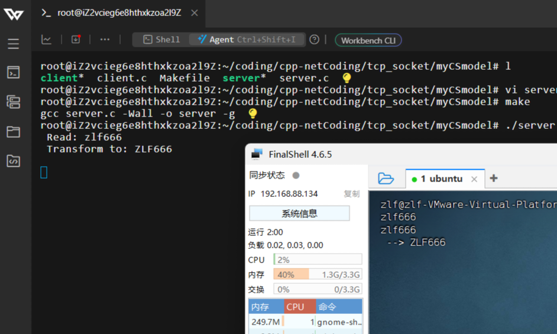

# cpp-netCoding

Linux 下 C/C++ 网络编程的学习与练习代码，覆盖基础 socket、并发模型、I/O 多路复用、线程池，直至第三方事件库与工程构建。

## 目录

- `socket_test/tcp_socket`：TCP 基础 C/S 模型（标准版 `CSmodel` 与手写版 `myCSmodel`），`wrap.c` 封装套接字 API
- `socket_test/mult_process_concurrent`：`fork` 多进程并发服务端
- `socket_test/mult_pthread_concurrent`：`pthread` 多线程并发服务端
- `udp_socket`：UDP 通信 C/S
- `domain_socket`：Unix 域 socket 本地通信
- `moreIO_concurrent`：I/O 多路复用，含 `select`/`poll`/`epoll`（ET、LT 模式）并发服务端
- `thread_pool`：线程池，任务队列加动态增减工作线程
- `libevent_test`：libevent 实践，`event` 事件（fifo 读写）与 `bufferevent` 网络 C/S
- `cmake-test`：CMake 构建练习（多源文件目录、静态/动态库）

## 构建运行

各子目录自带 `Makefile`，进入后执行 `make` 即可编译；CMake 示例见 `cmake-test/v1|v2`。

## 里程碑

本地虚拟机客户端与阿里云服务端首次通信：

另附 `Linux网络编程笔记.pdf`；`gitPush.sh` 为循环重试 push 的后台脚本。
